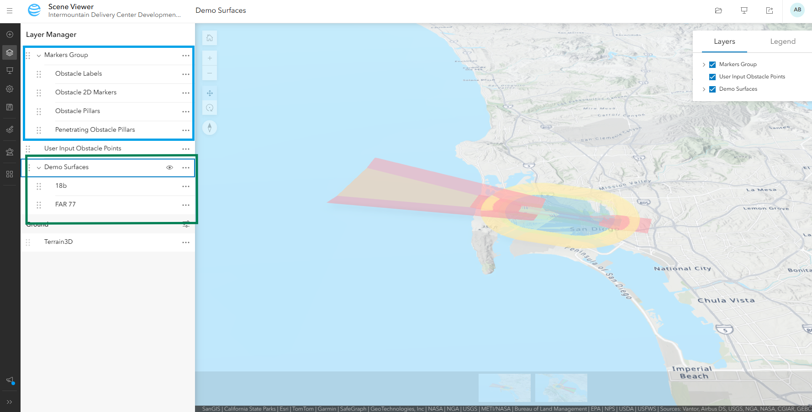
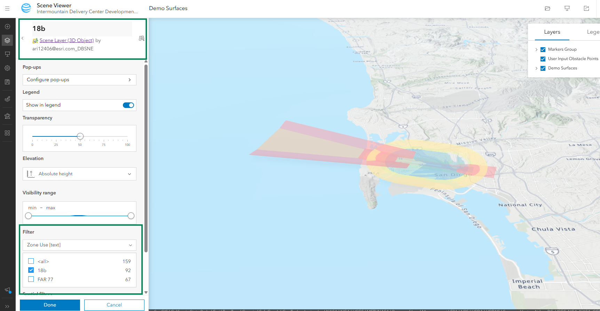
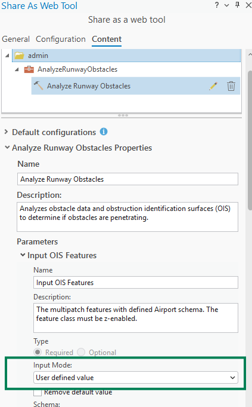

# Development & Deployment Guide

This guide describes everything required to develop, build, and deploy the
Obstacle Analysis application. For an overview of the application, see the
[README](README.md).

## Deployment Instructions

This section describes everything required to stand up the Obstacle Analysis
application in a **new environment**. The application is a static
**Vite + React + ArcGIS Maps SDK for JavaScript** build that talks to three
backend resources you must provision first:

1. A **Web Scene** (containing your OIS surface scene layers).
2. A published **`Analyze Runway Obstacles` geoprocessing (GP) web tool**.
3. An **OAuth application registration** in your ArcGIS Enterprise portal.


### 0. Prerequisites

- **ArcGIS Enterprise** (Server + Portal)
  - ArcGIS Enterprise versions 11.5 and newer are supported.
- An **Aviation license / extension** capable of running the
  `Analyze Runway Obstacles` GP tool in ArcGIS Pro.
- An account with **Creator** user type and privileges to publish hosted
  feature/scene layers and web tools.

- **Node.js** (LTS) and npm.
  - v22 or later

### 1. Publish the data layers

The OIS surfaces must exist as hosted layers in your Enterprise
portal. Start from the **provided sample GDBs** (sample_data folder), which contain sample OIS surfaces and the required script/support layers.

> **Using your own data:** When substituting your surfaces, 
> they must conform to the **same schema** as the sample GDB (matching field
> names, geometry types, and the required spatial reference described in
> Prerequisites). Mismatched schemas could cause the GP tool or app to fail.

1. In **ArcGIS Pro**, sign in to the target Enterprise portal.
2. Add each **OIS multipatch** layer from the Sample Data
   GDB to a global scene. (The sample GDB contains a single OIS multipatch layer
   holding the surfaces for San Francisco and San Deigo airports.)
3. Right-click the layer → **Sharing → Share As Web Layer**.
   - Use **Copy all data**.
   - Set the sharing level appropriately.
4. **Important — OIS surfaces:** Publishing a multipatch via *Share As Web
   Layer* creates a **paired Scene layer + Feature layer**, with the scene
   layer **associated** to the multipatch feature layer. The app relies on this
   association: the GP tool needs the multipatch feature layer, and the app
   discovers it from the scene layer. If the multipatch is published any other
   way that breaks this association, **analysis will fail**. (See
   `associatedLayer` usage in
   [EvaluateData.tsx](src/components/EvaluateObstacles/EvaluateData.tsx#L538-L539).)
5. In your Portal, go to the Content Page and select **New Item**. Browse to the **Supporting Layers** zipped GDB, select File     Geodatabase for the file type, and publish the supporting layers. 

### 2. Create the Web Scene

The app loads a single Web Scene by item ID (`sceneItemID` in `AppConfig.json`,
rendered into the `<arcgis-scene>` component in
[Map.jsx](src/components/Map/Map.jsx#L690)).

1. In the portal **Scene Viewer**, create a new web scene from the OIS layer by opening it in Scene Viewer.
2. Add the supporting layers to the scene. Leave the markers layers in a group and separate out User Input Obstacle Points. See first photo below (blue box).
3. **Organize the OIS surfaces as a group layer with per-surface-type
   sublayers.** Each sublayer title must match a `surfaceTypeField` domain value
   name, and the sublayer should be filtered to just that surface type. The demo OIS layer has two types of surfaces (18b and FAR 77) so add the layer to the web scene again, put each instance in a group layer, filter them by surface type, and title each instance based on the filter that was set. For the Demo Surfaces, we use the "Zone Use" field as the surface type, so this field should be filtered on. See the photos below for an example (green boxes):
   
   
4. Set the default camera/extent to your area of interest, and set each
   sublayer's **visibility** the way you want the app to start (the scene's
   saved visibility is captured as the default).
    - The scene's ground/elevation does not need to be set. Elevation is queried from the elevation service referenced in the config
5. Confirm each scene layer's **title** matches what you will put in
   `arrSceneLayersUserConfig[].title` (the app matches layers by title).
6. Optionally add supporting layers such as runways and imagery. You can typically add layers, change layer properties, and adjust web scene defaults without impacting the app functionality.
7. **Save** the scene and copy its **item ID** from the URL
   (`.../home/item.html?id=<ITEM_ID>`). This becomes `sceneItemID`.


### 3. Publish the `Analyze Runway Obstacles` GP web tool

1. In **ArcGIS Pro**, run the **`Analyze Runway Obstacles`** GP tool **once,
   successfully**, using:
   - **Input OIS Features**: your published (or local) OIS multipatch surfaces.
   - **Input Obstacle Features**: an obstacle point feature class in the
     required SR (**WGS 1984 Web Mercator + EGM2008**).
   - Defaults: Obstacle Features = **Absolute Height**, Obstacle Height =
     **Feature Geometry**.
2. Open **Geoprocessing History** → right-click the successful run →
   **Share As → Share Web Tool**.
3. Give it a unique name; choose **Copy all data**; set sharing level.
4. On the **Content** tab (pencil icon), set parameter input modes:
   - **`input_ois_features`** → *User defined value*.
   - **`input_obstacle_features`** → *User defined value*.
   - 
5. **Analyze**, resolve warnings/errors, then **Publish**.
6. Open the published tool's item page and copy the **full GP service URL**
   ending in `.../GPServer/Analyze%20Runway%20Obstacles`. This becomes `gpUrl`.

### 4. Register the OAuth application

The app authenticates users via OAuth 2.0 using the ArcGIS JS API
`OAuthInfo` / `IdentityManager` (configured in
[main.jsx](src/main.jsx#L51-L66)). It uses a **redirect** flow with a callback page at **`oauth-callback.html`**
(see [oauth-callback.html](oauth-callback.html)).

1. In your Enterprise portal, go to **Content → New item → Application** and
   create a **Web Mapping Application** registration to obtain a **Client ID (App ID)**.
2. Add **Redirect URIs** for every origin the app will be served from, e.g.:
   - `https://your-host` (and/or `https://your-host:port`)
   - `http://localhost:5173` for local development (Vite default dev port).
3. Copy the **App ID (Client ID)** → becomes `APP_ID` in `AppConfig.json`.
4. Set `PORTAL_URL` to your Enterprise portal root, e.g.
   `https://your-portal.example.com/portal`.

### 5. Configure the application (`AppConfig.json`)

Edit [public/config/AppConfig.json](public/config/AppConfig.json) (this file is
fetched at **runtime**, so it can be changed per environment without rebuilding).
Set at minimum:

```jsonc
{
  "PORTAL_URL": "https://your-portal.example.com/portal", // Step 4
  "APP_ID": "<your-oauth-app-id>",                         // Step 4
  "ELEVATION_LAYER_URL": "https://elevation3d.arcgis.com/arcgis/rest/services/WorldElevation3D/Terrain3D/ImageServer",
  "gpUrl": "https://your-server/.../GPServer/Analyze%20Runway%20Obstacles", // Step 3
  "sceneItemID": "<your-web-scene-item-id>",               // Step 2
  "arrSceneLayersUserConfig": [
    {
      "title": "<scene layer title, must match the Web Scene>",
      "surfaceFriendlyNameField": "NAME",
      "surfaceUnfriendlyNameField": "DESCRIP",
      "surfaceTypeField": "ZONEUSE",
      "surfaceStateField": "runwaystate"
    }
  ]
}
```

See [CONFIGURATION.md](CONFIGURATION.md) for the full set of options (theming,
units, layer names, runway state, etc.).

### 6. Build the application

From the repository root:

```powershell
npm install
npm run build
```

This produces a static **`dist/`** folder.

> **Run locally:** Use `npm run dev` to start the Vite dev server and run the
> app locally (default `http://localhost:5173`) without producing a build.

**Base path:** The build is configured with `base: "/obstacle-analysis/"`
([vite.config.js](vite.config.js#L11)). The app **must be served from a path
ending in `/obstacle-analysis/`** (e.g. `https://your-host/obstacle-analysis/`).
If you need a different path or root hosting, update `base` and the
`themingUserConfig.logo.path` / asset paths accordingly, then rebuild.


### 7. Deploy the static site

Deploy the contents of **`dist/`** to any static web host (IIS, NGINX, Apache,
Azure Static Web Apps, S3 + CloudFront, etc.). Requirements:

- Serve over **HTTPS** (required for OAuth and ArcGIS services).
- Serve the app under the **`/obstacle-analysis/`** path (matching `base`).
- Ensure **`oauth-callback.html`** is reachable at the deployed base
  (it is emitted to `dist/` and used by the OAuth redirect flow).
- The deployed origin/redirect URI must be **registered** on the OAuth app
  (Step 4).

**Example — IIS**

1. Copy the `dist/` contents to a folder, e.g. `C:\inetpub\obstacle-analysis`.
2. In **IIS Manager**, add an **Application** (or virtual directory) with alias
   **`obstacle-analysis`** pointing at that folder.
3. Browse to `https://your-host/obstacle-analysis/`.

### 8. Post-deployment validation

1. Load `https://your-host/obstacle-analysis/` and complete the OAuth sign-in.
2. Confirm the **Web Scene** and OIS layers render.
3. **Draw a point** (or **upload a sample CSV** from `public/samples/`) to add
   an obstacle.
4. Run **Evaluate** and confirm GP results return and penetrating obstacles are
   flagged.
5. Test **CSV export / Excel export**.
