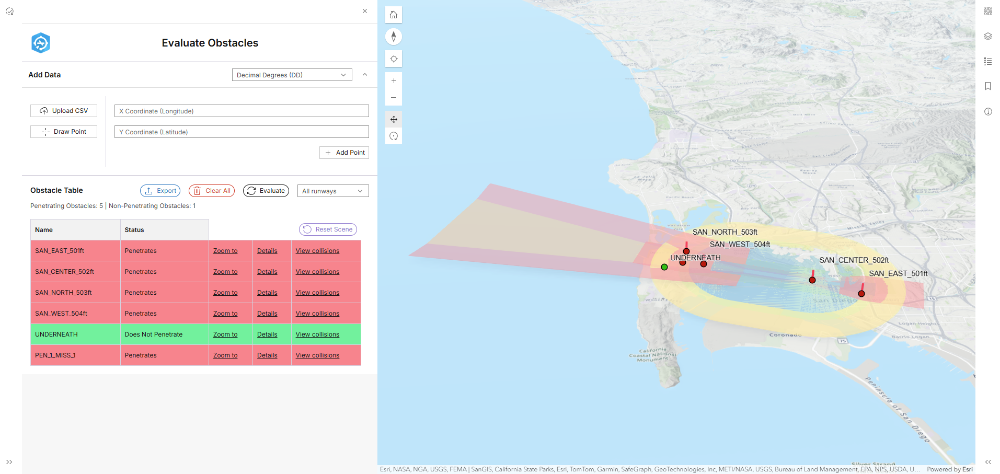

# Obstacle Analysis Application

An ArcGIS-based application for analyzing runway obstacles and evaluating their impact on aviation operations.

Built with Vite, React, and the ArcGIS Maps SDK for JavaScript, the app renders a 3D Web Scene of Obstacle Identification Surfaces (OIS) and lets users add obstacle points by drawing on the map or uploading a CSV. It runs the `Analyze Runway Obstacles` geoprocessing tool against those surfaces to determine which obstacles penetrate them and by how much. Results are visualized in the scene and can be reviewed in detail and exported to CSV or Excel for reporting.

---

## Development & Deployment

For complete instructions on how to develop, build, and deploy the application
in a new environment — including publishing data layers, creating the Web Scene,
publishing the GP web tool, registering OAuth, configuring `AppConfig.json`,
building, and deploying the static site — see
[DEVELOP_AND_DEPLOY.md](DEVELOP_AND_DEPLOY.md).

## Contributing

Esri welcomes contributions from anyone and everyone. Please see our [guidelines for contributing](https://github.com/esri/contributing).

## Licensing

Copyright 2026 Esri

Licensed under the Apache License, Version 2.0 (the "License");
you may not use this file except in compliance with the License.
You may obtain a copy of the License at

http://www.apache.org/licenses/LICENSE-2.0

Unless required by applicable law or agreed to in writing, software
distributed under the License is distributed on an "AS IS" BASIS,
WITHOUT WARRANTIES OR CONDITIONS OF ANY KIND, either express or implied.
See the License for the specific language governing permissions and
limitations under the License.

A copy of the license is available in the repository's [LICENSE.txt](LICENSE.txt) file.
